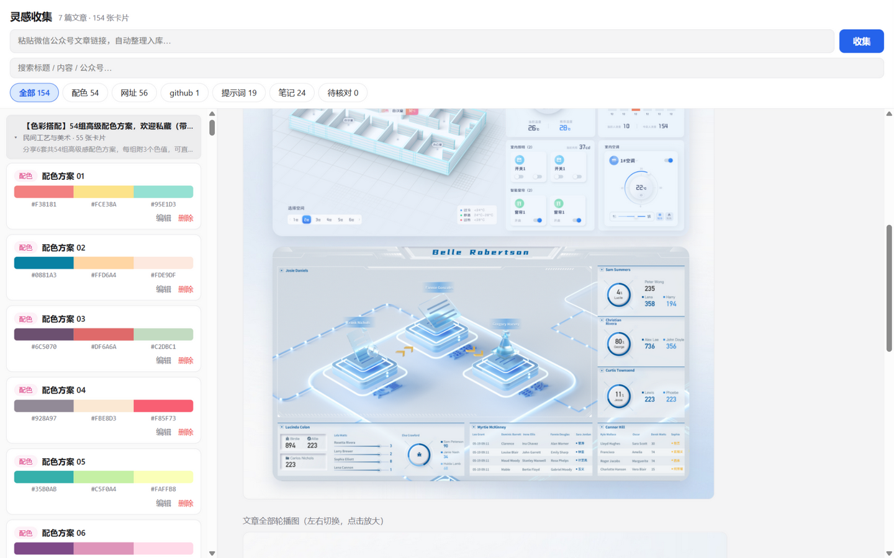

# 灵感收集 Inspiration Collector

把值得留存的微信公众号文章链接丢进来，自动抓取并用视觉大模型把内容**拆解成一张张"可复制的灵感卡片"**——配色（含色值）、网址、GitHub 项目、提示词、方法论笔记——形成可检索、可校验、可持续积累的本地灵感库。



## 为什么做这个

公众号好文（尤其设计/工具类）大多以图片形式排版，收藏等于进黑洞。灵感收集把"收藏"变成"拆解入库"：

- **配色方案** → 大色块 + `#十六进制`，点一下就复制，色值经原图像素采样校验；
- **便利网址 / GitHub 项目** → 整条复制或直接打开，自动探活标记失效链接；
- **提示词** → 全文逐字抄录，一键复制；
- **方法论** → AI 整理成带目录的笔记，可复制为 Markdown；
- 每张卡片保留**来源文章**和**图内定位裁剪图**（bbox），可对照原图核查修正。

## 功能特性

- **一键收集**：复制微信公众号文章链接，或在界面粘贴提交，进入后台任务队列；兼容传统图文与新版"图片消息"（轮播图）两种页面格式。
- **可恢复的任务队列**：手动提交、剪贴板和手机收件箱统一串行处理，分析期间继续复制新链接也会排队；可查看等待、处理、完成和失败状态，失败后可重试。普通未完成任务在重启后继续处理。
- **保留已有内容**：普通重复收藏跳过提取，保留手动编辑的卡片。显式重跑需确认，成功后整篇替换；抓取、图片下载、模型输出或写库失败时保留旧卡片和原图。
- **左列表 + 右详情**：列表按来源文章分组（父=文章及摘要，子=卡片），可折叠；详情页含定位裁剪图与全文轮播画廊，左右滑动查看原文所有插图。
- **单层分类**：全部 / 配色 / 网址 / github / 提示词 / 笔记 / 待核对，加全局搜索与栏宽拖拽。卡片分页加载完整结果，不再只显示前 500 张。
- **校验闭环**：色值与原图像素比对（超阈值标"待核对"）、网址探活（404/域名不存在标"已失效"）、卡片可编辑删除。
- **本地保存**：SQLite、原图、任务记录和配置保存在本机；分析时会把文章图文发送给你配置的模型服务。可选的公网收件箱只中转链接及任务状态，详见下方「工作原理」与「隐私」。

## 安装

从 [Releases](https://github.com/everalone/inspiration-collector/releases) 下载（Windows x64，未签名，SmartScreen 提示选"仍要运行"）：

- `InspirationCollector-Portable-x.x.x.exe`：**绿色单文件，双击即用**，无需安装；
- `InspirationCollector-Setup-x.x.x.exe`：安装版，带开始菜单/桌面快捷方式，可选安装目录。

两个版本数据互通（都存 `%AppData%\灵感收集\`）。

**首次使用**：启动后自动弹出设置（或点右上角 ⚙ 设置），填写你自己的 API Key、Base URL 和支持图片输入的 OpenAI 兼容模型。预填地址和模型名称只是初始配置，请以服务商实际支持的模型为准；模型调用费用由你配置的账户承担。

新安装默认没有 API Key、收件箱地址或 Token，手机收集默认关闭。别人从 GitHub 下载后需要自行配置，不会自动使用作者的服务器或模型账户。配置保存在本机，密钥不随源码或安装包分发。

### 从源码运行

需要可直接使用 `node:sqlite` 的 Node.js；CI 使用 Node.js 22 系列。打包后的桌面版自带运行时，用户无需另装 Node.js。

```bash
git clone https://github.com/everalone/inspiration-collector.git
cd inspiration-collector
npm ci
npm run app     # 先编译核心，再启动开发态桌面应用；在设置里填写自己的配置
npm run serve   # 可选：仅启动本机网页服务，浏览器访问 http://127.0.0.1:5178
npm run typecheck
npm test        # 临时目录、测试数据与模拟模型的回归检查
npm run dist    # 打包 Setup + Portable（输出到 release/）
```

`npm run app` 与 `npm run serve` 是两种启动方式，不要同时占用默认端口。开发态默认使用项目根的 `data/`、`assets/`；打包版默认使用 `%AppData%\灵感收集\`，彼此分离。需要隔离测试时可显式设置 `INSPIRATION_DATA_DIR` 指向另一数据目录；应用内配置优先于该数据目录的 `.env` 和进程环境变量。

### 发版（维护者）

推送形如 `v0.2.0` 的标签后，GitHub Actions 在 Windows 执行类型检查、回归测试、打包与包内容检查，通过后创建 Release（Setup + Portable + `latest.yml`）。标签版本必须与 `package.json` 的 `version` 一致，否则流水线失败。发布记录以 GitHub 实际结果为准；0.2.0 的改动与验证范围见 [版本说明](docs/releases/v0.2.0.md)。

```bash
# 1. 改 package.json 的 version，例如 0.2.0，提交并推到 main
# 2. 打同名标签并推送
git tag v0.2.0
git push origin main --tags
```

## 使用

- **收集**：复制文章链接 → 任务排队 → 抓取、下载正文图、模型拆卡、校验、入库。提交成功表示已排队，完成后才提示入库结果。手机上刷到的文章也可复制链接发微信"文件传输助手"，再到电脑复制。
- **查看任务**：点「任务」或打开设置，查看进度与失败原因。普通收集失败可手动重试；手机任务先由收件箱有限重试，最终失败后在手机失败列表「重新排队」。关闭设置或把窗口缩到托盘不会取消任务；退出程序后，普通未完成任务待下次启动恢复。
- **手机自动收集（可选）**：部署 [`inbox/`](inbox/README.md) 到你的 VPS+域名后，在设置里填 HTTPS 收件箱 URL 与 Token 并启用。iPhone 快捷指令使用分享的 URL，向 `https://你的域名/collect` 发 POST（`Authorization: Bearer <token>`，JSON `{"url":"…"}`）。电脑运行应用时默认每 30 秒检查，可设为 10–120 秒。电脑不在线时只在服务器排队，不执行分析。一个 Token 是一个个人共享队列，只安排一台桌面程序消费。
- **断线恢复**：手机任务分析失败默认最多尝试 3 次，再进入失败列表；处理结果先写本地回执，服务器确认暂时失败时只补发确认，不会因此重新付费分析。设置内可查看连接错误和待确认数量。
- **卡片墙**：左侧列表点选卡片，右侧查看详情与来源原图；色块/网址/提示词点击即复制；笔记目录芯片跳转。
- **编辑**：每张卡可改标题/色值/网址/内容，可删除；"待核对"页签集中处理存疑项。
- **显式重跑**：文章右键「重跑」，或在设置中选择文章并「重跑选中」。确认后重新抓取并分析，成功时替换该文全部旧卡片，包括手动修改；**不自动合并或备份**。执行中断的重跑不会直接自动再跑，需先检查已有结果再决定重试。
- **数据与备份**：完全退出程序后，备份数据目录中的整个 `data/` 与 `assets/`。`data/` 包含 `inspiration.db`、`config.json`、`tasks.json`、`inbox-receipts.json` 和原文缓存；不要只复制数据库而漏掉图片、任务与回执。配置含个人密钥，请妥善保存备份。

### 从旧版升级

1. 在托盘菜单选择「退出」，备份 `%AppData%\灵感收集\` 下的 `data/` 和 `assets/`。
2. 安装新版，或使用新版 Portable 启动；默认继续使用原数据目录。已有文章、卡片和旧图片目录可继续读取。
3. 打开任务与设置，确认模型配置和可选收件箱配置。普通重复收藏保留手改卡片；需要更新旧提取结果时再主动重跑。
4. 若已部署公网收件箱，还需备份云端 `inbox.jsonl`、更新 `inbox/server.mjs` 并重启服务。仅更新桌面安装包不会升级你的服务器。手机快捷指令的 URL、Token 和请求格式保持不变，详见 [收件箱升级说明](inbox/README.md#升级与验收)。

新桌面可继续连接旧收件箱，但失败列表、手动重新排队和服务器自动退避需要新版服务端；完整的断线恢复行为建议桌面与收件箱一起升级。

## 工作原理

```
手动输入 / 剪贴板 ───────────────────┐
手机分享 → 你的公网收件箱 → 本机拉取 ──┤
                                    ↓
                            本机持久化任务队列
                                    ↓
                    本机抓取微信文章与正文图片
                                    ↓
                  把图文发送给你配置的视觉模型 API
                                    ↓
                     本机校验色值 / 请求网址探活
                                    ↓
                      本机 SQLite + 原图 → 卡片墙

手机任务处理结果 → 本地保存回执 → 向收件箱确认
```

核心引擎（`core/`）负责任务和唯一的收件箱轮询，桌面壳（`src-electron/`）负责窗口、剪贴板与通知。打包态由 Electron 内置 Node 运行核心服务；SQLite 使用 Node 内置 `node:sqlite`。卡片墙服务默认只监听本机 `127.0.0.1`，不是可直接向公众开放的多用户网站。

## 隐私

- **本地保存**：文章缓存、下载的原图、卡片数据库、任务记录和设置保存在本机；程序不自动把完整卡片库同步到作者的服务器。
- **文章抓取**：本机会访问微信文章页面和图片 CDN。
- **模型分析**：文章文字、元数据和压缩图片会发送到你填写的模型 API；API Key 用于该服务的请求鉴权。是否保存这些请求、如何使用数据，由所选模型服务商的政策决定。
- **网址校验**：本机会访问提取出的目标网址，以判断链接是否可用。
- **可选公网收件箱**：手机上传文章链接和可选备注；桌面上传处理结果与错误状态。部署该服务的服务器会保存这些信息，但不会代为运行模型或收到完整本地卡片库。
- **密钥与分发**：API Key 和收件箱 Token 保存在本地配置中，请勿公开该文件；`.env`、`data/`、`assets/` 不进入源码分发，安装包不包含用户配置或数据库。你的 Token 只用于你配置的收件箱请求，不能公开给其他用户共用。
