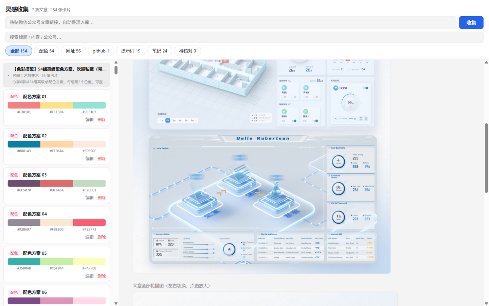

# 灵感收集 Inspiration Collector

把值得留存的微信公众号文章链接丢进来，自动抓取并用视觉大模型把内容**拆解成一张张"可复制的灵感卡片"**——配色（含色值）、网址、GitHub 项目、提示词、方法论笔记——形成可检索、可校验、可持续积累的本地灵感库。

**v2.5.0** 统一按钮、输入框、标签与卡片的组件规格，优化分类卡固定间距，并增加逐条删除失败任务记录。包含此前 v0.2.4.1 的应用内更新、手机收集和 Portable 修复。下载见 [v2.5.0 Release](https://github.com/everalone/inspiration-collector/releases/tag/v2.5.0)，完整变化见 [版本说明](docs/releases/v2.5.0.md)。



*上图为旧版卡片详情示意；v0.2.4 已更新主题与文章浏览方式。*

## 为什么做这个

公众号好文（尤其设计/工具类）大多以图片形式排版，收藏等于进黑洞。灵感收集把"收藏"变成"拆解入库"：

- **配色方案** → 大色块 + `#十六进制`，点一下就复制，色值经原图像素采样校验；
- **便利网址 / GitHub 项目** → 整条复制或直接打开，自动探活标记失效链接；
- **提示词** → 全文逐字抄录，一键复制；
- **方法论** → AI 整理成带目录的笔记，可复制为 Markdown；
- 每张卡片保留**来源文章**和**图内定位裁剪图**（bbox），可对照原图核查修正。

## 功能特性

- **一键收集**：复制微信公众号文章链接，或在界面粘贴提交，进入后台任务队列；兼容传统图文与新版"图片消息"（轮播图）两种页面格式。
- **可恢复的任务队列**：手动提交、剪贴板和手机收件箱统一串行处理，分析期间继续复制新链接也会排队；可查看等待、处理、完成和失败状态，失败后可重试。普通未完成任务在重启后继续处理。
- **清楚的任务状态**：对应收集或重跑后来成功时，先前失败记录从当前列表和失败计数中移除。默认显示最近10条已完成任务；「清空已完成记录」归档完成记录，「删除记录」逐条移除失败及其较早尝试，刷新和重启不重新出现。两种操作都保留文章、卡片和处理回执。
- **应用内更新**：Windows 安装版和便携版自动检查新版本，在最小化按钮左侧下载更新、重启安装；继续使用原数据目录。正在处理任务或确认手机回执时，会提示稍后再安装。
- **统一标题栏**：品牌、设置、任务、更新和窗口按钮整合为一行，采用圆角和淡色磨砂效果；支持拖动、双击最大化/还原，关闭窗口继续驻留托盘。
- **保留已有内容**：普通重复收藏跳过提取，保留手动编辑的卡片。显式重跑需确认，成功后整篇替换；抓取、图片下载、模型输出或写库失败时保留旧卡片和原图。
- **文章优先浏览**：「全部」只展示文章父卡片，含作者、摘要、卡片数量及分类。右侧文章总览显示标题、作者、导入时间、分类数量与原图；启动时不展开子卡片。
- **两种分类入口**：顶部分类先选文章，再进入该文章的对应子卡片；文章总览中的分类卡片直接进入该文章对应子卡片。支持返回文章列表、搜索与栏宽拖拽，卡片分页加载完整结果。
- **阅读反馈**：分类标签与卡片徽标颜色一致；24px 圆角分类卡、卡片悬停上浮、按钮按下缩至 97%。原图支持按钮、左右方向键和横向拖动切换，伴随扇形滑动；分类栏下的 3px 进度条跟随右侧阅读位置。
- **提交反馈**：任务按钮显示处理中、已完成或失败，仍可点击查看记录；同一链接正在排队或处理中时，收集按钮禁止重复提交。手机任务沿用每轮最多 3 次处理的规则。
- **校验闭环**：色值与原图像素比对（超阈值标"待核对"）、网址探活（404/域名不存在标"已失效"）、卡片可编辑删除。
- **可定位的失败报告**：模型响应不合格或卡片字段校验失败时，记录图片批次、卡片序号/名称、字段与固定原因；手机任务每轮最多处理 3 次，最终失败后停止自动重试。
- **本地保存**：SQLite、原图、任务记录和配置保存在本机；分析时会把文章图文发送给你配置的模型服务。可选的公网收件箱保存链接、完成标题、任务状态及脱敏后的失败报告，详见下方「工作原理」与「隐私」。

## 安装

从 [v2.5.0 Release](https://github.com/everalone/inspiration-collector/releases/tag/v2.5.0) 下载（Windows x64，安装包未做代码签名；核对下载来源后，可在 SmartScreen 的「更多信息」中选择「仍要运行」）：

- [InspirationCollector-Portable-2.5.0.exe](https://github.com/everalone/inspiration-collector/releases/download/v2.5.0/InspirationCollector-Portable-2.5.0.exe)：**绿色单文件，双击即用**，无需安装；
- [InspirationCollector-Setup-2.5.0.exe](https://github.com/everalone/inspiration-collector/releases/download/v2.5.0/InspirationCollector-Setup-2.5.0.exe)：安装版，带开始菜单/桌面快捷方式，可选安装目录。

两个版本数据互通（都存 `%AppData%\灵感收集\`）。

**首次使用**：启动后自动弹出设置（或点顶部 ⚙ 设置），填写你自己的 API Key、Base URL 和支持图片输入的 OpenAI 兼容模型。预填地址和模型名称只是初始配置，请以服务商实际支持的模型为准；模型调用费用由你配置的账户承担。

新安装默认没有 API Key、收件箱地址或 Token，手机收集默认关闭。别人从 GitHub 下载后需要自行配置，不会自动使用作者的服务器或模型账户。配置保存在本机，密钥不随源码或安装包分发。

### 应用内更新

Windows x64 安装版和便携版在启动约 **10 秒后**检查更新，运行期间每 **6 小时**再检查一次。更新按钮位于标题栏右侧、最小化按钮左边，也可随时点击手动检查。

发现新版本后，点击「下载更新」；下载完成并校验通过后，按钮变为「重启更新」。点击后应用退出、安装并重新启动。下载期间可以继续使用；如果还有排队或处理中的任务、正在同步手机收件箱，或手机回执尚未确认，程序会保留下载结果并提示稍后再安装。

Setup 和 Portable 更新均沿用 `%AppData%\灵感收集\`，保留已有文章、卡片、图片和设置。源码开发态和普通浏览器不执行应用内安装。连接 GitHub 或下载校验失败时，可在更新面板重试，当前版本继续可用。

**v0.2.2 本身没有更新器**：需从 GitHub 下载 v0.2.4.1 手动升级一次；此后的版本可通过应用内更新。

**v0.2.3 / v0.2.4 升级到 v0.2.4.1 需先手动换包一次**：旧更新器仅识别三段版本号；v0.2.4.1 起同时支持三段和四段补丁版本。

### 测试旧版本（本项目开发环境）

双击项目根目录的 [`launch-old-version.cmd`](launch-old-version.cmd)，输入所需版本的序号。入口会为每次测试创建独立临时目录、独立端口和空白测试库，可以与正式版本同时运行；测试数据位于 `data/isolated-versions/`，退出后保留。

- 保留旧版对应的 `release-*` 目录、Portable 和 `win-unpacked`，并确保开发环境已安装 Node.js 与项目依赖。
- 测试库默认无 API Key、关闭手机收件箱，不复制正式文章、设置或回执。需要测试在线导入时，在测试窗口单独填写配置。
- 退出测试版使用该窗口对应的托盘菜单 →「退出」；下次运行入口会新建另一个空测试库。
- 现有 v0.2.0–v0.2.4 支持隔离；更早的 v0.1.x 把数据目录或端口写死，入口会跳过。旧版仍可能读取剪贴板，测试前可先复制一段普通文字。

日常使用新版本入口。需要对比旧版时使用上面的测试入口：直接双击旧 Portable 仍会使用正式数据目录，同一份旧便携包重复启动还会触发其原有的解压清理问题。

### 从源码运行

需要可直接使用 `node:sqlite` 的 Node.js；CI 使用 Node.js 22 系列。打包后的桌面版自带运行时，用户无需另装 Node.js。

```bash
git clone https://github.com/everalone/inspiration-collector.git
cd inspiration-collector
npm ci
npm run app     # 先编译核心，再启动开发态桌面应用；在设置里填写自己的配置
npm run serve   # 可选：仅启动本机网页服务，浏览器访问 http://127.0.0.1:5178
npm run typecheck
npm test        # 临时目录、测试数据与模拟模型的回归检查
npm run dist    # 打包 Setup + Portable（输出到 release/）
```

`npm run app` 与 `npm run serve` 是两种启动方式，不要同时占用默认端口。开发态默认使用项目根的 `data/`、`assets/`；打包版默认使用 `%AppData%\灵感收集\`，彼此分离。需要隔离测试时可显式设置 `INSPIRATION_DATA_DIR` 指向另一数据目录；应用内配置优先于该数据目录的 `.env` 和进程环境变量。

### 组件与布局规格

**v2.5.0** 汇总本地 v0.2.4.2–v0.2.4.4 已验收的组件同步、分类卡间距和失败记录删除；这些本地阶段不单独公开发布。分类卡从左到右排列，横向8px、换行17px固定间距。见[完整版本说明](docs/releases/v2.5.0.md)。

[组件设计规格说明书](component-spec.md)以2026-11-11确认的Figma组件为设计基线，覆盖尺寸、颜色、文字、状态、组合与布局规则，并标明尚未定义的部分。2026-11-12已同步按钮、输入状态、分类标签、文章/配色卡、分类统计卡、弹窗与画廊；v2.5.0安装包包含这些界面修改。

新规格样式集中在 `viewer/components.css`，加载在既有布局样式之后；尚未定义的键盘、重试、任务和响应式行为继续使用原实现。字体优先使用本机Noto Sans SC，缺少时回退微软雅黑/Segoe UI，不联网加载。隔离视觉验收运行 `node_modules/.bin/electron scripts/verify-components.cjs`，模拟数据截图与尺寸记录写入 `data/ui-check-20261112/`，不访问正式数据库或模型。

[Figma视觉验证原型](https://www.figma.com/design/HfHdEVOq8WrzSG9LOgoN0O?node-id=6-2)保留可点击界面与组件规范两页，包含9个界面/尺寸对照、9个浮层、57个母组件和8个变体集。分类卡靠左和失败记录删除按钮尚待回写，最终实现规则见规格第7.3与11节。

### 发版（维护者）

在明确决定发布后，推送形如 `v2.5.0` 的标签，GitHub Actions 在 Windows 执行类型检查、回归测试、打包、包内容边界、打包运行时以及 Portable 重复启动后的图片加载检查，通过后创建 Release。发布包含 **4 个文件：Setup、Portable、`latest.yml`、`update.json`**；`update.json` 记录安装包版本、下载地址、大小与 SHA-256，供应用检查和校验更新。正文来自对应的 `docs/releases/<标签>.md`。发布记录以 GitHub 实际结果为准。

四段补丁版本在 npm 中写为合法 SemVer `0.2.4+1`，由 `src-electron/version.mjs` 转为对外的 `0.2.4.1`；`package-lock.json` 同步内部版本，`build.buildVersion` 为外部版本，`build.buildNumber` 为第四段。标签和文件名使用外部版本，CI 校验映射一致。不要用 `npm version` 写入 `+1`（当前 npm 会剥离该部分）。当前 electron-builder 26.15.3 的 `portable.unpackDirName: true` 表示每次启动独立解压；升级构建工具时必须重跑实际 Portable 双启动测试。

```bash
# 1. 同步 package.json、package-lock.json 和版本说明，提交并推到 main
# 2. 打同名标签并推送
git tag v2.5.0
git push origin v2.5.0
```

## 使用

- **收集**：复制文章链接 → 任务排队 → 抓取、下载正文图、模型拆卡、校验、入库。提交成功表示已排队，完成后才提示入库结果。手机上刷到的文章也可复制链接发微信"文件传输助手"，再到电脑复制。
- **查看任务**：点「任务」或打开设置，查看进度及失败报告中的批次、卡片和字段。对应收集或重跑后来成功后，旧失败不再占据列表或失败计数；最近 10 条已完成任务可用「清空已完成记录」归档，不会删除文章或卡片。手机任务默认每轮共 3 次（首次处理 + 2 次重试），最终失败后在手机失败列表选择「重新排队（新一轮）」。再次分享同一失败链接不会开启新一轮。关闭设置或把窗口缩到托盘不会取消任务；退出程序后，普通未完成任务待下次启动恢复。
- **手机自动收集（可选）**：部署 [`inbox/`](inbox/README.md) 到你的 VPS+域名后，在设置里填 HTTPS 收件箱 URL 与 Token 并启用。iPhone 快捷指令使用分享的 URL，向 `https://你的域名/collect` 发 POST（`Authorization: Bearer <token>`，JSON `{"url":"…"}`）。电脑运行应用时默认每 30 秒检查，可设为 10–120 秒。电脑不在线时只在服务器排队，不执行分析。一个 Token 是一个个人共享队列，只安排一台桌面程序消费。
- **断线恢复**：处理结果先写本地任务记录和回执，再确认服务器；相同任务 ID、处理轮次与尝试序号已有落盘结果时复用结果。ACK 或微信通知失败时仅补发对应回执或通知，不消耗分析次数、不再次调用收费模型。未完成且尚无持久结果的处理仍可能在恢复后执行。设置内可查看连接错误和待确认数量。
- **微信 ClawBot（可选）**：按 [桥接部署说明](inbox/clawbot.md) 绑定后，把公众号文本链接发给机器人即可收集。入队后回复一次；电脑完成导入并回执后，再回复 `《文章名》已解析成功并导入灵感收集。` 最终失败时回复已用次数、停止自动重试及脱敏的字段报告。完成标题由桌面解析结果回传，需使用 v0.2.2 或更新的配套桌面与服务器。文章卡片直接转发不属于当前接收格式。
- **卡片墙**：「全部」先点文章查看总览，再点右侧分类数量卡进入该篇子卡片。顶部分类则先筛选文章，点文章后进入子卡片。左侧「返回文章」保留当前分类；右侧「文章总览」可重新选择该文章的分类。搜索在当前浏览范围内生效，从文章总览点分类卡时会清除旧搜索。
- **阅读与复制**：原图可用左右箭头、方向键或横向拖动切换，点击放大；右侧阅读进度显示在顶部分类栏下。色块/网址/提示词点击即复制，笔记目录芯片跳转。
- **编辑**：每张卡可改标题/色值/网址/内容，可删除；"待核对"页签集中处理存疑项。
- **显式重跑**：文章右键「重跑」，或在设置中选择文章并「重跑选中」。确认后重新抓取并分析，成功时替换该文全部旧卡片，包括手动修改；**不自动合并或备份**。执行中断的重跑不会直接自动再跑，需先检查已有结果再决定重试。
- **数据与备份**：完全退出程序后，备份数据目录中的整个 `data/` 与 `assets/`。`data/` 包含 `inspiration.db`、`config.json`、`tasks.json`、`inbox-receipts.json` 和原文缓存；不要只复制数据库而漏掉图片、任务与回执。配置含个人密钥，请妥善保存备份。

### 从旧版升级

v0.2.2 没有应用内更新入口；本地 v0.2.3 / v0.2.4 的更新器仅识别三段版本号。升级到 v0.2.4.1 都需先手动换包一次，之后可使用标题栏的更新按钮。

1. 在托盘菜单选择「退出」，备份 `%AppData%\灵感收集\` 下的 `data/` 和 `assets/`。
2. 安装新版，或使用新版 Portable 启动；默认继续使用原数据目录。已有文章、卡片和旧图片目录可继续读取。
3. 打开任务与设置，确认模型配置和可选收件箱配置。普通重复收藏保留手改卡片；需要更新旧提取结果时再主动重跑。

**从 v0.2.2 升到 v0.2.4.1 无需改动服务器**：已有 v0.2.2 收件箱与 ClawBot 可继续使用，快捷指令的 URL、Token 和请求格式保持不变。

以下云端升级步骤只适用于**从 v0.2.1 或更早版本升级到 v0.2.2 功能，且服务器尚未升级**的用户：备份云端 `inbox.jsonl`，配套更新 `inbox/server.mjs` 与 `inbox/failure-report.mjs`；使用 ClawBot 时还需保留其私有状态，并更新 `inbox/clawbot-bridge.mjs`、`inbox/clawbot-messages.mjs`，共 4 个服务端文件，再重启对应服务。仅更新桌面安装包不会升级服务器，详见 [收件箱升级说明](inbox/README.md#升级与验收)。

v0.2.2 引入的结构化报告、每轮停止、跨重启结果复用和旧回执隔离，需要配套的桌面与服务器；更早版本的组合只提供基本收集能力。

### 模型输出与本地校验

五种卡片使用统一的 `payload` 结构；本地兼容旧顶层字段、字符串色值、三位十六进制等格式等价写法。缺少 `http://` 或 `https://`、但可保留的原文网址转换为笔记，保留原串和说明，不猜测补齐为可点击链接。真实缺失、类型错误、无效颜色/网址或截断 JSON 会形成结构化失败报告。

提取请求使用 `temperature: 0` 减少采样变化，但不保证模型输出确定一致。程序不会额外调用模型来修复校验错误；手机任务只按本轮剩余次数重试。一次文章处理可以包含多个图片批次，因此「最多 3 次」指文章处理尝试，不等于最多 3 次模型 API 请求。

## 工作原理

```
手动输入 / 剪贴板 ───────────────────┐
手机分享 → 你的公网收件箱 → 本机拉取 ──┤
                                    ↓
                            本机持久化任务队列
                                    ↓
                    本机抓取微信文章与正文图片
                                    ↓
                  把图文发送给你配置的视觉模型 API
                                    ↓
                     本机校验色值 / 请求网址探活
                                    ↓
                      本机 SQLite + 原图 → 卡片墙

手机任务处理结果 → 本地保存回执 → 向收件箱确认
```

核心引擎（`core/`）负责任务和唯一的收件箱轮询，桌面壳（`src-electron/`）负责窗口、剪贴板与通知。打包态由 Electron 内置 Node 运行核心服务；SQLite 使用 Node 内置 `node:sqlite`。卡片墙服务默认只监听本机 `127.0.0.1`，不是可直接向公众开放的多用户网站。

## 隐私

- **本地保存**：文章缓存、下载的原图、卡片数据库、任务记录和设置保存在本机；程序不自动把完整卡片库同步到作者的服务器。
- **文章抓取**：本机会访问微信文章页面和图片 CDN。
- **模型分析**：文章文字、元数据和压缩图片会发送到你填写的模型 API；API Key 用于该服务的请求鉴权。是否保存这些请求、如何使用数据，由所选模型服务商的政策决定。
- **网址校验**：本机会访问提取出的目标网址，以判断链接是否可用。
- **更新检查**：应用只向本项目固定的 GitHub 发布源及其下载服务获取版本和安装包，不发送文章、卡片、API Key、收件箱 Token 或私有配置；更新不经过作者的收件箱服务器。
- **可选公网收件箱**：手机上传文章链接和可选备注；桌面上传成功后的文章标题及处理状态，失败时上传脱敏的结构化报告（批次、卡片序号/名称、字段和固定原因码）。报告不含模型原始响应、提示词、请求头或 API Key。ClawBot 桥接保存接收游标及待通知上下文，并向绑定者回复状态、标题和最终失败摘要。服务器不代为运行模型，也不保存完整本地卡片库。
- **密钥与分发**：API Key 和收件箱 Token 保存在本地配置中，请勿公开该文件；`.env`、`data/`、`assets/` 不进入源码分发，安装包不包含用户配置或数据库。你的 Token 只用于你配置的收件箱请求，不能公开给其他用户共用。
